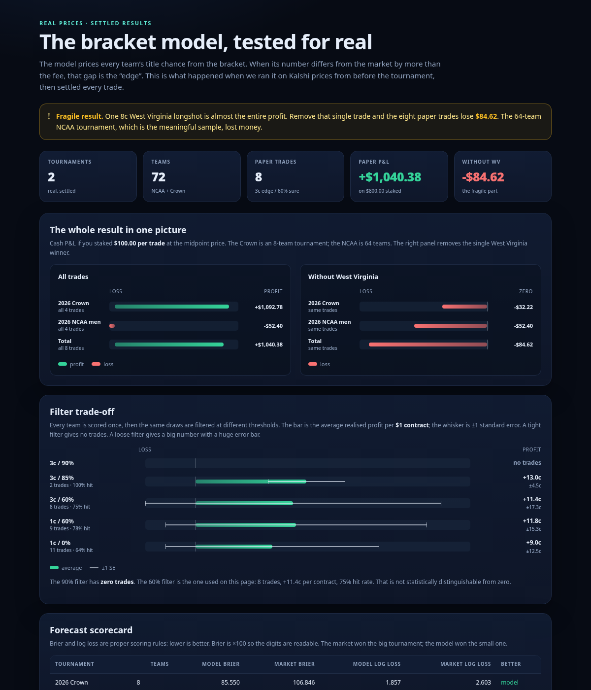
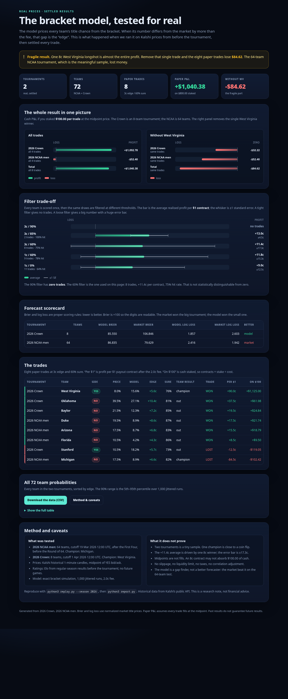

# Bracket Edge

**A real test of a prediction-market model — not a money printer.**



The model reads bracket prices, turns them into a title probability for every team, and flags
where its number differs from the market by more than the fee. This repo is the honest test:
**real Kalshi prices, real 2026 tournaments, settled results.**

The short version: it made money on paper, but **one 8c longshot is almost the whole profit**.
The 64-team NCAA tournament lost money, and the market beat the model there.

---

## The result

| What | Trades | Staked | P&L | Return |
|---|---:|---:|---:|---:|
| All paper trades | 8 | $800 | **+$1,040.38** | +130% |
| Without West Virginia | 7 | $700 | **−$84.62** | −12% |
| 2026 NCAA only | 4 | $400 | **−$52.40** | −13% |
| 2026 Crown only | 4 | $400 | **+$1,092.78** | +273% |

At **3c edge / 60% sure**, staking **$100 cash per trade** at the midpoint:

- **8 trades, 75% hit rate**
- **+11.4c per $1 contract, ±17.3c**
- The best trade: West Virginia YES at **8c**, won, **+$1,125.00**
- The worst: Stanford YES at 10.5c, lost, **−$119.05**

The $1,040 headline is real arithmetic, not a forecast. It is also **fragile**: remove the one
8c winner and the same seven trades lose $84.62. An 8c contract also may not absorb $100 of
cash in a thin market, so the fill is optimistic.



[**Open the full interactive report →**](https://ibi-bit.github.io/bracket-edge/)

---

## How a trade works

A price is a probability. **17.5c means the market thinks there is a 17.5% chance.**

- **Buy YES** at the ask. Pay the price. One contract pays **$1** if the team wins.
- **Buy NO** at `1 − YES ask`. One contract pays **$1** if the team does **not** win.
- **Fees** are subtracted in the model (2c per contract here). Real fees can differ.

Example from the ledger — **Duke NO at 19.5c**:

```
YES price        19.5c
NO cost          80.5c          (1 − 0.195)
$100 buys        124.2 contracts ($100 ÷ 0.805)
Duke did not win → payout $124.20
Profit           +$24.20 − fee ≈ +$21.74
```

That is the `On $100` column in the report. It is **cash staked**, not payout.

### Selling before the result

You do not have to hold to settlement. Prediction markets let you sell at the current **bid**:

```
P&L = (sell price − buy price) × contracts − fees
```

Selling early lowers variance and can lock in a gain, but you pay the spread and may cap the
upside. **This backtest does not sell early.** Every trade is held to settlement and pays $1 or $0.
That makes the numbers simpler and more honest, but it is not the only way to trade.

---

## What the model does

1. **Devig** each two-way game price, removing the platform margin.
2. **Fit a rating** for every team so rating gaps match the game probabilities, pulled toward an
   Elo prior from the regular season.
3. **Simulate the exact bracket** to get a title probability for every team.
4. **Jitter** the game prices and priors 1,000 times to see how stable the answer is.
5. **Compare** model probability with the market price:

```
YES edge = model − price − fee
NO  edge = price − model − fee
```

A trade is flagged when **edge ≥ 3c** and **sure ≥ 60%**. The 90% filter from the original
version produced **zero trades** on real data, which is why this report uses the risky 60% filter.

**“Sure” is not the chance of winning.** It is the share of 1,000 jittered model runs in which
the trade still shows a profit. It measures how sensitive the edge is to the inputs.

---

## Error bars, in plain English

The filter table shows the average realised profit per **$1 contract** and **±1 standard error**:

| Min edge | Min sure | Trades | Hit | Per $1 | ±1 SE |
|---:|---:|---:|---:|---:|---:|
| 3c | 90% | 0 | — | — | — |
| 3c | 85% | 2 | 100% | +13.0c | ±4.5c |
| **3c** | **60%** | **8** | **75%** | **+11.4c** | **±17.3c** |
| 1c | 60% | 9 | 78% | +11.8c | ±15.3c |
| 1c | 0% | 11 | 64% | +9.0c | ±12.5c |

The 60% row says “+11.4c, give or take 17.3c.” That range includes **negative numbers**, so
eight trades are **not proof of an edge**. The 85% row looks perfect, but two trades is noise.
The 90% row is honest and useless: it never fires.

Rule of thumb: if the error bar crosses zero, you have a story, not a signal. You need **30+
trades across several seasons** before the average means much.

---

## Why the result is split

| Tournament | Teams | Model Brier | Market Brier | Model log loss | Market log loss | Better |
|---|---:|---:|---:|---:|---:|---|
| 2026 Crown | 8 | 85.550 | 106.846 | 1.857 | 2.603 | model |
| 2026 NCAA men | 64 | 86.835 | 79.629 | 2.416 | 1.942 | market |

Brier and log loss are proper scoring rules: **lower is better**. Brier is ×100 in this table.
The model won the small 8-team Crown and lost the 64-team NCAA. The overall “model is better”
number is a small-tournament effect, not a robust improvement.

An **efficient market** already has the right price; the model’s edge is then just model error,
and trading loses. A **mispriced market** has real gaps, and some of them pay. You do not know
which market you are in. That is why the real replay matters more than the synthetic backtest.

The 2026 NCAA market was efficient enough. The model’s “edges” were mostly NO bets on favorites;
three won, but **NO Michigan lost 84.5c** when Michigan won the title. One champion broke the
whole 64-team result.

---

## Polymarket cross-check

Polymarket's 2026 title market is liquid, so I swapped **only the title prices** and kept the
same Kalshi bracket, game prices, Elo priors, and Michigan winner. That isolates the title-market
comparison.

| Market | Title prices sum | Top prices | Trades at 3c / 60% | P&L |
|---|---:|---|---:|---:|
| Kalshi | 1.22 | Duke 19.5, Michigan 17.5, Arizona 17.5 | 4 | −10.7c |
| Polymarket | 1.054 | Michigan 18.5, Duke 18.5, Arizona 18.3 | 4 | **−10.8c ±24.3** |

The same four **NO** bets appear on both venues: Michigan, Arizona, Florida, Duke. The model lost
on Polymarket too. Its Brier was **1.36 vs 1.19** for the market, and log loss **0.0381 vs 0.0272**.
The 90% filter gives **zero trades** on both.

Polymarket's first-round **game** markets are too thin for a full bracket: several have no trade
history at the cutoff (Tennessee/Miami, for example), so there is no honest game price to use.
Title-only is the comparison the data supports.

### Betfair

**Blocked without an account.** The Exchange API needs an application key and session token, and
historical odds come from the paid Historic Data service. There are no credentials in this
environment, so Betfair is not included and nothing is faked. To add it, provide
`BETFAIR_APP_KEY` and `BETFAIR_SESSION_TOKEN` plus historical-package access.

---

## What the graphs show

The full report has four visuals:

- **The whole result** — cash P&L with all trades, and the same ledger with West Virginia removed.
  The right panel is the honest one: every bar is below zero.
- **Filter trade-off** — average profit and ±1 SE at each threshold. Tight filters give no trades;
  loose filters give a big number with a huge error bar.
- **Forecast scorecard** — Brier and log loss, model vs market, per tournament.
- **The trades** — all eight paper trades with price, model, edge, sure, result, and cash P&L.

---

## Run it

Only **numpy** is needed for the model.

```bash
python3 -m venv .venv
source .venv/bin/activate
pip install numpy

# Rebuild the two real replay CSVs (optional; they are committed)
python3 replay.py --season 2026 --label m_ncaa_2026 --out replays/m_ncaa_2026.csv

python3 replay.py --season 2026 --title-event KXNCAAMBCBC-26 \
  --cutoff 2026-04-01T12:00:00+00:00 \
  --prior-cutoff 2026-04-01T12:00:00+00:00 \
  --label m_crown_2026 --out replays/m_crown_2026.csv

# Sweep the filters and rebuild the report
python3 sweep.py --dir replays --fee 0.02 --draws 1000
python3 report.py

# Polymarket title-only cross-check
python3 fetch_polymarket.py
python3 sweep.py --dir cross --fee 0.02 --draws 1000

# Open the self-contained page
python3 -m http.server 8000
# http://127.0.0.1:8000/report.html
```

Tests:

```bash
python3 test_bracket_edge.py   # 15 checks
```

---

## Why only two tournaments?

That is the data limit, not a choice:

- **NIT** — excluded. Title quotes were stale 50/50 and summed to 11.5, not ~1.
- **Women’s NCAA** — bracket incomplete; one Nebraska game is missing, so it builds 63 teams.
- **2025 men’s** — Kalshi’s game archive starts in Nov 2025; no 2025 tournament game prices.
- **Conference tournaments** — byes; the current tree builder assumes a full power-of-two bracket.

The valid set is **2 tournaments, 72 teams, 36 first-round games**. More seasons would make the
error bars smaller, but the data is not there yet.

---

## Repo layout

| File | What it does |
|---|---|
| `bracket_edge.py` | Model: devig, rating fit, bracket simulation, edge/sure/action |
| `replay.py` | Fetch real historical Kalshi prices and build a replay CSV |
| `sweep.py` | Score the replay under many filters, with error bars |
| `report.py` | Build the self-contained HTML report and CSV |
| `backtest.py` | Synthetic backtest (the wind tunnel, not the real test) |
| `fetch_kalshi.py` | Live Kalshi prices for current markets |
| `fetch_polymarket.py` | Polymarket title prices, mapped onto the Kalshi bracket |
| `visual.py` | Model-vs-market viewer for one CSV |
| `replays/` | The two real tournament CSVs |
| `cross/` | The Polymarket title-only cross-check |
| `report.html` | The shareable report (no external assets) |
| `report.png` | Full-page screenshot |
| `report_data.csv` | Every team's model, market, edge, sure, and result |

Main prices are from Kalshi’s public historical API: 1-minute candles, midpoint of YES bid/ask,
at a cutoff before the tournament. The Polymarket cross-check uses its public title market at the
same cutoff. Ratings use regular-season Elo only. No future games, no lookahead.

---

## Limits

- Two tournaments and eight trades is a tiny sample. One champion is close to a coin flip.
- Midpoints are not fills. A $100 stake on an 8c contract is 1,250 contracts; liquidity may not
  support it.
- No slippage, taxes, or correlation adjustment. The eight trades are not independent bets.
- The model is a **gap finder**, not a better forecaster: the market beat it on the 64-team test.
- This is a research note, **not financial advice**.

If you want to take it further: paper trade at 3c / 60%, log every trade, and wait for 30+
settled trades across multiple seasons. If the average stays positive and the error bar stops
crossing zero, then it is worth believing.
